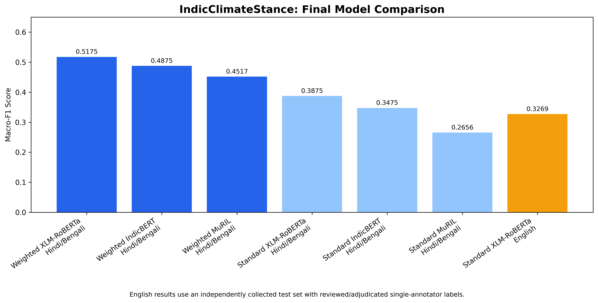
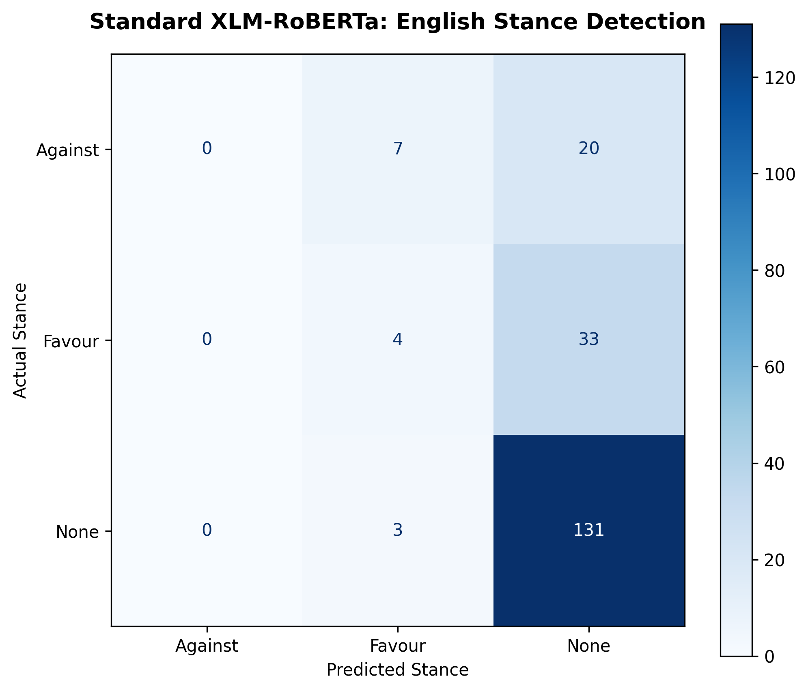

# IndicClimateStance

### Multilingual Climate Change Stance Detection Using NLP

IndicClimateStance is an NLP research project focused on identifying the stance expressed in Hindi and Bengali YouTube comments toward the claim:

> Climate change and global warming is a serious concern.

The project also evaluates cross-lingual generalization by testing a model trained on Hindi and Bengali comments against a separately collected English dataset.

## 1. Problem Statement

The task is to classify comments into three stance categories:

- **Favour:** Supports or agrees with the target claim.
- **Against:** Opposes or disagrees with the target claim.
- **None:** Does not express a clear stance toward the target claim.

Stance detection differs from sentiment analysis because the goal is to identify a comment's position toward a specific claim, rather than simply its positive or negative sentiment.

## 2. Dataset

### Hindi and Bengali Dataset

The model development experiments used:

| Split      | Samples |
| ---------- | ------: |
| Training   |     304 |
| Validation |      77 |
| Total      |     381 |

The dataset contains Hindi and Bengali YouTube comments with three stance labels.

### English Evaluation Dataset

A separate set of 198 English YouTube comments was collected for cross-lingual evaluation.

The comments were manually labeled, reviewed, and adjudicated by a single annotator.

| Stance    | Samples |
| --------- | ------: |
| Against   |      27 |
| Favour    |      37 |
| None      |     134 |
| **Total** | **198** |

The English evaluation set was collected from one YouTube video and has a substantial class imbalance.

Raw comments and row-level predictions are not included in the public repository.

## 3. Models and Experiments

The project evaluates three multilingual transformer architectures:

1. XLM-RoBERTa
2. IndicBERT
3. MuRIL

For each architecture, two training configurations were evaluated:

- Standard fine-tuning
- Class-weighted fine-tuning

Class weighting was explored to address the imbalanced stance distribution.

## 4. Hindi and Bengali Validation Results

| Model                |   Accuracy |   Macro-F1 | Weighted-F1 |
| -------------------- | ---------: | ---------: | ----------: |
| Weighted XLM-RoBERTa | **0.7792** | **0.5175** |  **0.7817** |
| Weighted IndicBERT   |     0.7403 |     0.4875 |      0.7435 |
| Weighted MuRIL       |     0.6753 |     0.4517 |      0.6788 |
| Standard XLM-RoBERTa |     0.7273 |     0.3875 |      0.6575 |
| Standard IndicBERT   |     0.6753 |     0.3475 |      0.6086 |
| Standard MuRIL       |     0.6623 |     0.2656 |      0.5278 |

**Weighted XLM-RoBERTa achieved the highest validation macro-F1 of 0.5175.**

## 5. English Cross-Lingual Evaluation

The available Standard XLM-RoBERTa checkpoint was evaluated on the 198 reviewed and adjudicated English comments.

The weighted XLM-RoBERTa checkpoint was not available for this evaluation. Therefore, the English results should not be interpreted as the cross-lingual performance of the best weighted model.

### Overall Performance

| Metric                | Result |
| --------------------- | -----: |
| Accuracy              | 0.6818 |
| Macro-F1              | 0.3269 |
| Weighted-F1           | 0.5869 |
| Correct predictions   |    135 |
| Incorrect predictions |     63 |

### Per-Class Results

| Class   | Precision | Recall |     F1 | Support |
| ------- | --------: | -----: | -----: | ------: |
| Against |    0.0000 | 0.0000 | 0.0000 |      27 |
| Favour  |    0.2857 | 0.1081 | 0.1569 |      37 |
| None    |    0.7120 | 0.9776 | 0.8239 |     134 |

### Confusion Matrix

Rows represent true labels; columns represent predicted labels.

| Actual / Predicted | Against | Favour | None |
| ------------------ | ------: | -----: | ---: |
| Against            |       0 |      7 |   20 |
| Favour             |       0 |      4 |   33 |
| None               |       0 |      3 |  131 |

The model predicted the None class for 184 of 198 examples and did not predict the Against class for any example.

Its 68.18% accuracy is only slightly higher than the 67.68% accuracy of an always-None majority-class baseline.

## 6. Visualizations

### Model Comparison



### English Confusion Matrix



## 7. Key Findings

- Class-weighted training improved validation macro-F1 for all three transformer architectures.
- Weighted XLM-RoBERTa performed best on the Hindi/Bengali validation set.
- Standard XLM-RoBERTa showed a strong preference for predicting None on the English evaluation set.
- The model failed to identify Against examples in the English test set.
- Accuracy alone was misleading because the English dataset was heavily imbalanced.
- Macro-F1 and per-class recall provided a more informative assessment of performance.

## 8. Limitations

- The datasets contain relatively few examples, particularly for the Against class.
- The English evaluation set was collected from a single YouTube video.
- English annotations were produced and reviewed by a single annotator; inter-annotator agreement was not measured.
- The English evaluation used Standard XLM-RoBERTa rather than the best-performing weighted checkpoint.
- Differences between the Hindi/Bengali validation data and English test data prevent a controlled causal conclusion about the effect of language transfer alone.
- The findings should not be generalized to all climate-related discussions or social media platforms.

## 9. Repository Structure

```text
IndicClimateStance/
├── data/                    # Local datasets (excluded from Git)
├── models/                  # Local model checkpoints (excluded from Git)
├── notebooks/               # Experiment notebooks
├── report/                  # Project documentation
├── results/
│   └── english_evaluation/  # Aggregate English evaluation artifacts
├── src/                     # Training and evaluation code
├── .gitignore
└── README.md
```

## 10. Reproducibility and Data Privacy

The repository includes source code and aggregate evaluation results.

Raw datasets, individual YouTube comments, row-level predictions, environment secrets, and trained model checkpoints are excluded from the public repository.

Reproducing the experiments requires access to the corresponding datasets and compatible model checkpoints.

## 11. Conclusion

IndicClimateStance demonstrates multilingual transformer-based stance detection for Hindi and Bengali climate discussions.

The experiments show that class-weighted fine-tuning can improve performance on imbalanced validation data. The English evaluation also highlights important limitations in cross-lingual generalization, particularly for minority stance categories.

Future improvements may include collecting more balanced datasets, evaluating additional English sources, and conducting controlled cross-lingual comparisons.
